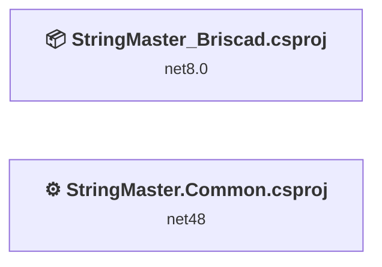
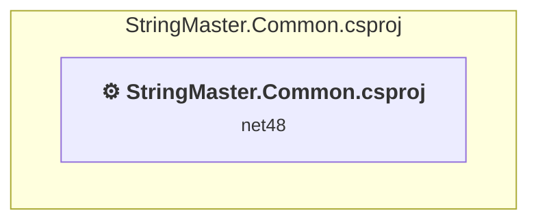
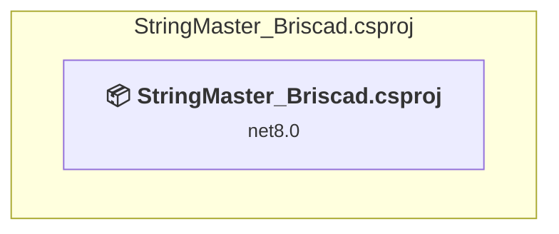

# Projects and dependencies analysis

This document provides a comprehensive overview of the projects and their dependencies in the context of upgrading to .NETCoreApp,Version=v8.0.

## Table of Contents

- [Executive Summary](#executive-Summary)
  - [Highlevel Metrics](#highlevel-metrics)
  - [Projects Compatibility](#projects-compatibility)
  - [Package Compatibility](#package-compatibility)
  - [API Compatibility](#api-compatibility)
  - [Binding Redirect Configuration](#binding-redirect-configuration)
- [Aggregate NuGet packages details](#aggregate-nuget-packages-details)
- [Top API Migration Challenges](#top-api-migration-challenges)
  - [Technologies and Features](#technologies-and-features)
  - [Most Frequent API Issues](#most-frequent-api-issues)
- [Projects Relationship Graph](#projects-relationship-graph)
- [Project Details](#project-details)

  - [StringMaster.Common\StringMaster.Common.csproj](#stringmastercommonstringmastercommoncsproj)
  - [StringMaster_Briscad\StringMaster_Briscad.csproj](#stringmaster_briscadstringmaster_briscadcsproj)

## Executive Summary

### Highlevel Metrics

| Metric | Count | Status |
| :--- | :---: | :--- |
| Total Projects | 2 | 1 require upgrade |
| Total NuGet Packages | 0 | All compatible |
| Total Code Files | 21 |  |
| Total Code Files with Incidents | 9 |  |
| Total Lines of Code | 1206 |  |
| Total Number of Issues | 98 |  |
| Estimated LOC to modify | 96+ | at least 8.0% of codebase |

### Projects Compatibility

| Project | Target Framework | Difficulty | Package Issues | API Issues | Binding Issues | Est. LOC Impact | Description |
| :--- | :---: | :---: | :---: | :---: | :---: | :---: | :--- |
| [StringMaster.Common\StringMaster.Common.csproj](#stringmastercommonstringmastercommoncsproj) | net48 | 🟡 Medium | 0 | 96 | 0 | 96+ | ClassicWpf, Sdk Style = False |
| [StringMaster_Briscad\StringMaster_Briscad.csproj](#stringmaster_briscadstringmaster_briscadcsproj) | net8.0 | ✅ None | 0 | 0 | 0 |  | ClassLibrary, Sdk Style = True |

### Package Compatibility

| Status | Count | Percentage |
| :--- | :---: | :---: |
| ✅ Compatible | 0 | 0.0% |
| ⚠️ Incompatible | 0 | 0.0% |
| 🔄 Upgrade Recommended | 0 | 0.0% |
| ***Total NuGet Packages*** | ***0*** | ***100%*** |

### API Compatibility

| Category | Count | Impact |
| :--- | :---: | :--- |
| 🔴 Binary Incompatible | 96 | High - Require code changes |
| 🟡 Source Incompatible | 0 | Medium - Needs re-compilation and potential conflicting API error fixing |
| 🔵 Behavioral change | 0 | Low - Behavioral changes that may require testing at runtime |
| ✅ Compatible | 271 |  |
| ***Total APIs Analyzed*** | ***367*** |  |

## Aggregate NuGet packages details

| Package | Current Version | Suggested Version | Projects | Description |
| :--- | :---: | :---: | :--- | :--- |

## Top API Migration Challenges

### Technologies and Features

| Technology | Issues | Percentage | Migration Path |
| :--- | :---: | :---: | :--- |
| Windows Forms | 6 | 6.3% | Windows Forms APIs for building Windows desktop applications with traditional Forms-based UI that are available in .NET on Windows. Enable Windows Desktop support: Option 1 (Recommended): Target net9.0-windows; Option 2: Add <UseWindowsDesktop>true</UseWindowsDesktop>; Option 3 (Legacy): Use Microsoft.NET.Sdk.WindowsDesktop SDK. |
| WPF (Windows Presentation Foundation) | 4 | 4.2% | WPF APIs for building Windows desktop applications with XAML-based UI that are available in .NET on Windows. WPF provides rich desktop UI capabilities with data binding and styling. Enable Windows Desktop support: Option 1 (Recommended): Target net9.0-windows; Option 2: Add <UseWindowsDesktop>true</UseWindowsDesktop>. |

### Most Frequent API Issues

| API | Count | Percentage | Category |
| :--- | :---: | :---: | :--- |
| T:System.Windows.MessageBoxResult | 24 | 25.0% | Binary Incompatible |
| T:System.Windows.MessageBoxImage | 8 | 8.3% | Binary Incompatible |
| T:System.Windows.MessageBoxButton | 8 | 8.3% | Binary Incompatible |
| T:System.Windows.MessageBox | 4 | 4.2% | Binary Incompatible |
| M:System.Windows.MessageBox.Show(System.String,System.String,System.Windows.MessageBoxButton,System.Windows.MessageBoxImage) | 4 | 4.2% | Binary Incompatible |
| T:System.Windows.Forms.DialogResult | 4 | 4.2% | Binary Incompatible |
| T:System.Windows.Visibility | 4 | 4.2% | Binary Incompatible |
| T:System.Windows.Media.SolidColorBrush | 2 | 2.1% | Binary Incompatible |
| P:Microsoft.Win32.FileDialog.FileName | 2 | 2.1% | Binary Incompatible |
| M:Microsoft.Win32.CommonDialog.ShowDialog | 2 | 2.1% | Binary Incompatible |
| P:Microsoft.Win32.FileDialog.Filter | 2 | 2.1% | Binary Incompatible |
| P:Microsoft.Win32.FileDialog.DefaultExt | 2 | 2.1% | Binary Incompatible |
| F:System.Windows.MessageBoxButton.OK | 2 | 2.1% | Binary Incompatible |
| F:System.Windows.MessageBoxResult.OK | 2 | 2.1% | Binary Incompatible |
| F:System.Windows.MessageBoxResult.None | 2 | 2.1% | Binary Incompatible |
| F:System.Windows.MessageBoxResult.No | 2 | 2.1% | Binary Incompatible |
| F:System.Windows.MessageBoxResult.Yes | 2 | 2.1% | Binary Incompatible |
| F:System.Windows.MessageBoxResult.Cancel | 2 | 2.1% | Binary Incompatible |
| F:System.Windows.MessageBoxImage.Question | 2 | 2.1% | Binary Incompatible |
| F:System.Windows.Forms.DialogResult.OK | 2 | 2.1% | Binary Incompatible |
| T:System.Windows.Media.BrushConverter | 1 | 1.0% | Binary Incompatible |
| M:System.Windows.Media.BrushConverter.#ctor | 1 | 1.0% | Binary Incompatible |
| T:Microsoft.Win32.OpenFileDialog | 1 | 1.0% | Binary Incompatible |
| M:Microsoft.Win32.OpenFileDialog.#ctor | 1 | 1.0% | Binary Incompatible |
| F:System.Windows.MessageBoxImage.Warning | 1 | 1.0% | Binary Incompatible |
| F:System.Windows.MessageBoxImage.Error | 1 | 1.0% | Binary Incompatible |
| F:System.Windows.MessageBoxButton.YesNoCancel | 1 | 1.0% | Binary Incompatible |
| F:System.Windows.MessageBoxButton.YesNo | 1 | 1.0% | Binary Incompatible |
| T:System.Windows.Window | 1 | 1.0% | Binary Incompatible |
| T:Microsoft.Win32.SaveFileDialog | 1 | 1.0% | Binary Incompatible |
| M:Microsoft.Win32.SaveFileDialog.#ctor | 1 | 1.0% | Binary Incompatible |
| T:System.Windows.DependencyPropertyChangedEventArgs | 1 | 1.0% | Binary Incompatible |
| F:System.Windows.Visibility.Hidden | 1 | 1.0% | Binary Incompatible |
| F:System.Windows.Visibility.Visible | 1 | 1.0% | Binary Incompatible |

## Projects Relationship Graph

Legend:
📦 SDK-style project
⚙️ Classic project

## Project Details

### StringMaster.Common\StringMaster.Common.csproj

#### Project Info

- **Current Target Framework:** net48
- **Proposed Target Framework:** net8.0-windows
- **SDK-style**: False
- **Project Kind:** ClassicWpf
- **Dependencies**: 0
- **Dependants**: 0
- **Number of Files**: 20
- **Number of Files with Incidents**: 9
- **Lines of Code**: 1199
- **Estimated LOC to modify**: 96+ (at least 8.0% of the project)

#### Dependency Graph

Legend:
📦 SDK-style project
⚙️ Classic project

### API Compatibility

| Category | Count | Impact |
| :--- | :---: | :--- |
| 🔴 Binary Incompatible | 96 | High - Require code changes |
| 🟡 Source Incompatible | 0 | Medium - Needs re-compilation and potential conflicting API error fixing |
| 🔵 Behavioral change | 0 | Low - Behavioral changes that may require testing at runtime |
| ✅ Compatible | 271 |  |
| ***Total APIs Analyzed*** | ***367*** |  |

#### Project Technologies and Features

| Technology | Issues | Percentage | Migration Path |
| :--- | :---: | :---: | :--- |
| Windows Forms | 6 | 6.3% | Windows Forms APIs for building Windows desktop applications with traditional Forms-based UI that are available in .NET on Windows. Enable Windows Desktop support: Option 1 (Recommended): Target net9.0-windows; Option 2: Add <UseWindowsDesktop>true</UseWindowsDesktop>; Option 3 (Legacy): Use Microsoft.NET.Sdk.WindowsDesktop SDK. |
| WPF (Windows Presentation Foundation) | 4 | 4.2% | WPF APIs for building Windows desktop applications with XAML-based UI that are available in .NET on Windows. WPF provides rich desktop UI capabilities with data binding and styling. Enable Windows Desktop support: Option 1 (Recommended): Target net9.0-windows; Option 2: Add <UseWindowsDesktop>true</UseWindowsDesktop>. |

### StringMaster_Briscad\StringMaster_Briscad.csproj

#### Project Info

- **Current Target Framework:** net8.0✅
- **SDK-style**: True
- **Project Kind:** ClassLibrary
- **Dependencies**: 0
- **Dependants**: 0
- **Number of Files**: 1
- **Lines of Code**: 7
- **Estimated LOC to modify**: 0+ (at least 0.0% of the project)

#### Dependency Graph

Legend:
📦 SDK-style project
⚙️ Classic project

### API Compatibility

| Category | Count | Impact |
| :--- | :---: | :--- |
| 🔴 Binary Incompatible | 0 | High - Require code changes |
| 🟡 Source Incompatible | 0 | Medium - Needs re-compilation and potential conflicting API error fixing |
| 🔵 Behavioral change | 0 | Low - Behavioral changes that may require testing at runtime |
| ✅ Compatible | 0 |  |
| ***Total APIs Analyzed*** | ***0*** |  |

